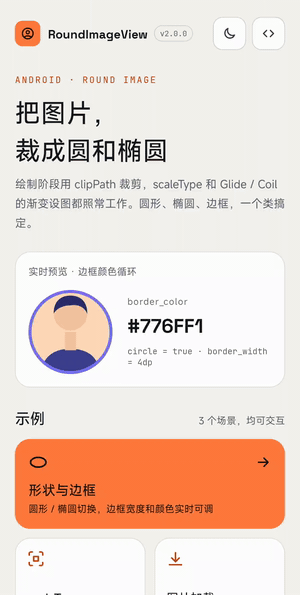
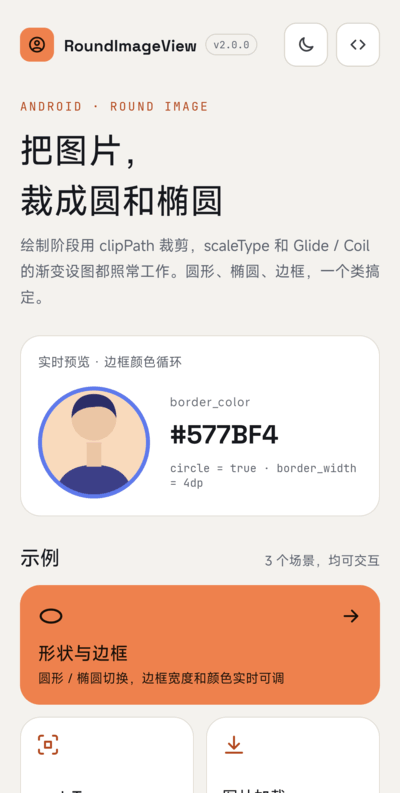
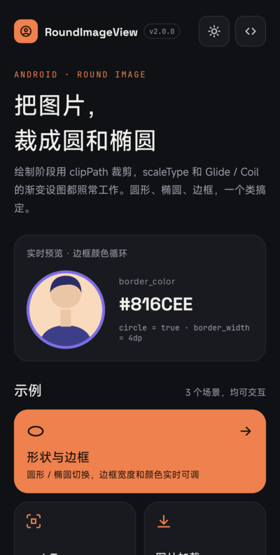
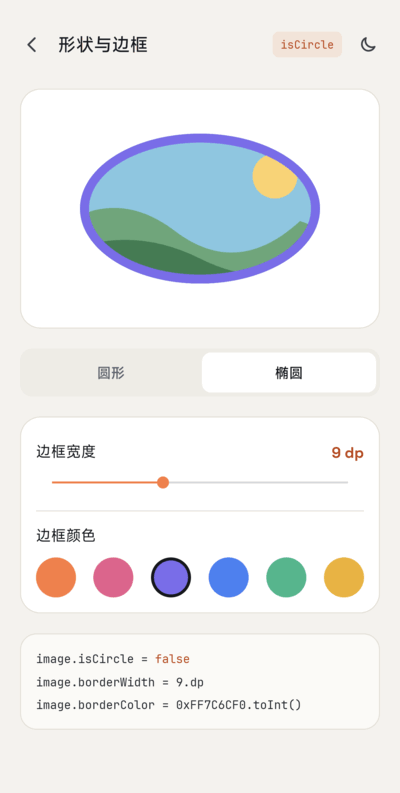
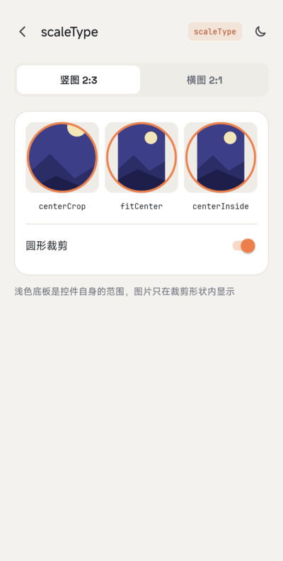
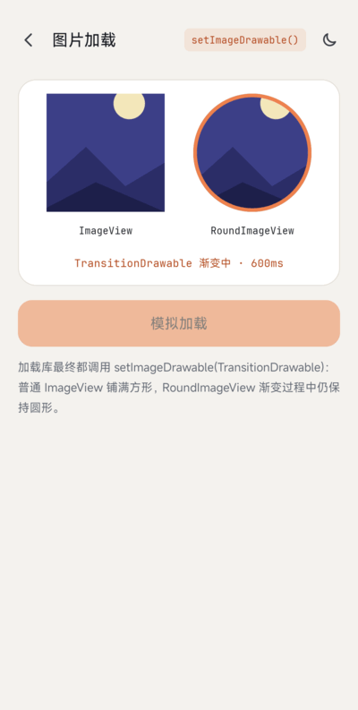

# RoundImageView

[English](README.md) | 简体中文

[](https://jitpack.io/#venshine/RoundImageView)  [](https://github.com/venshine/RoundImageView/actions/workflows/ci.yml)  [](https://developer.android.com/guide/topics/manifest/uses-sdk-element#ApiLevels)

把图片裁成圆形或椭圆、可加边框的 `ImageView`。Kotlin 编写，除 Kotlin 标准库外没有其他依赖。

## 截图



| 首页 | 深色模式 | 形状与边框 | scaleType |
|:---:|:---:|:---:|:---:|
|  |  |  |  |

| 图片加载 |
|:---:|
|  |

你需要它吗？
--
大多数项目已经不需要专门的库来做这件事：

* Material Components 的 [`ShapeableImageView`](https://developer.android.com/reference/com/google/android/material/imageview/ShapeableImageView) 支持圆形、圆角和描边。
* 图片加载库自带圆角变换（Glide 的 `CircleCrop` / `RoundedCorners`，Coil 的 `CircleCropTransformation` / `RoundedCornersTransformation`）。

RoundImageView 适合不想引入 Material Components 的项目：只有一个很小的类，支持任意 `Drawable`，并遵守 `scaleType`。

使用
--
##### Gradle：
1. 在 `settings.gradle` 里加入 JitPack 仓库：
```groovy
dependencyResolutionManagement {
    repositories {
        google()
        mavenCentral()
        maven { url = 'https://jitpack.io' }
    }
}
```
2. 在模块的 `build.gradle` 里加入依赖：
```groovy
implementation 'com.github.venshine:RoundImageView:2.0.0'
```

##### Gradle Kotlin DSL：
```kotlin
// settings.gradle.kts
dependencyResolutionManagement {
    repositories {
        google()
        mavenCentral()
        maven("https://jitpack.io")
    }
}

// build.gradle.kts
implementation("com.github.venshine:RoundImageView:2.0.0")
```

> 从 2.0.0 起库改用 Kotlin 编写并通过 JitPack 发布。旧坐标 `com.wx.ovalimageview:roundimageview` 已无法下载，Eclipse 用的 jar 也已移除。

示例
--
包名仍是 `com.wx.ovalimageview`。[示例 App](sample) 演示了圆形、椭圆、`scaleType` 和模拟图片加载库的渐变设图，支持浅色 / 深色主题。

##### XML：
```xml
<com.wx.ovalimageview.RoundImageView
    xmlns:app="http://schemas.android.com/apk/res-auto"
    android:layout_width="96dp"
    android:layout_height="96dp"
    android:scaleType="centerCrop"
    android:src="@mipmap/ic_launcher"
    app:border_color="#ff0000"
    app:border_width="2dp"
    app:circle="true" />
```

##### Kotlin：
```kotlin
val imageView = findViewById<RoundImageView>(R.id.round_imageview)
imageView.scaleType = ImageView.ScaleType.CENTER_CROP
imageView.borderColor = Color.RED
imageView.borderWidth = 10
imageView.isCircle = true
imageView.setImageResource(R.drawable.avatar)
```

##### Java：
```java
RoundImageView imageView = findViewById(R.id.round_imageview);
imageView.setScaleType(ImageView.ScaleType.CENTER_CROP);
imageView.setImageResource(R.drawable.avatar, Color.RED, 10, true);
```

##### Glide / Coil：
图片在绘制时裁剪，所以任何调用 `setImageDrawable` 的加载库都能用，包括渐变动画（`TransitionDrawable`）。在控件上设好 `scaleType`，其余交给加载库：

```kotlin
// Glide：不要再加 transform(CircleCrop())，控件本身已经会裁剪
Glide.with(this).load(url).into(imageView)

// Coil
imageView.load(url)
```

如果加载库自己做了 `centerCrop` / `fitCenter` 变换，结果在控件里如何摆放仍由控件的 `scaleType` 决定。

##### 属性：
| 属性 | 说明 |
|:---|:---|
| `border_color` | 边框颜色，完全透明表示不画边框 |
| `border_width` | 边框宽度，`0` 表示不画边框 |
| `circle` | `true` 按圆形裁剪（以内容区较短边为直径）；`false`（默认）按填满内容区的椭圆裁剪 |

##### 方法：
| 方法 | 说明 |
|:---|:---|
| `borderColor` / `setBorderColor(int)` | 获取 / 设置边框颜色 |
| `setBorderColor(String)` | 设置边框颜色，形如 `"#aarrggbb"` |
| `borderWidth` / `setBorderWidth(int)` | 获取 / 设置边框宽度，单位 px |
| `isCircle` / `setCircle(boolean)` | 获取 / 设置圆形模式 |
| `setImageResource(int, int, int, boolean)` | 设置图片，同时设置边框颜色、边框宽度、是否圆形 |
| `setImageDrawable(Drawable, int, int, boolean)` | 同上，传入 `Drawable` |
| `setImageBitmap(Bitmap, int, int, boolean)` | 同上，传入 `Bitmap` |

其余方法（`setScaleType`、`setImageDrawable`、padding 等）来自 `ImageView`。

从 1.x 迁移
--
* **坐标**：`com.wx.ovalimageview:roundimageview:1.1.0` 改为 `com.github.venshine:RoundImageView:2.0.0`；`minSdk` 提升到 21。
* **裁剪改在绘制阶段。** 所有模式都遵守 `scaleType`。默认是 `centerCrop`，图片铺满裁剪形状，和 1.x 圆形模式效果一致；XML 或样式里写了 `android:scaleType`，或之后调用 `setScaleType`，都以显式设置为准。1.x 的椭圆模式沿用 `ImageView` 默认的 `fitCenter`，想保持原样请设置 `android:scaleType="fitCenter"`。
* **支持任意 `Drawable`。** 1.x 把 Drawable 强转成 `BitmapDrawable`，遇到 `TransitionDrawable`、矢量图等会崩溃。`setImageDrawable(null)` 现在是清空图片，不再抛异常。
* **setter 立即重绘。** 1.x 的 `setBorderColor`、`setBorderWidth`、`setCircle` 只影响之后设置的图片。
* **移除 `RoundDrawable`。** 它只是实现细节，请直接使用 `RoundImageView`。
* **内容区。** 形状和边框跟随控件的 padding。
* 边框仍画在形状内侧，盖在图片外缘上。
* 形状用 `Canvas.clipPath` 裁剪。开启硬件加速（默认）时边缘有抗锯齿；软件画布上可能有锯齿。

维护状态
--
尽力维护。2.0.0 的 Kotlin 重写尚未在真机上验证；行为由 Robolectric 单元测试通过检查绘制出的像素来覆盖。

Credits
--
示例 App 打包了以下字体，均为 [SIL Open Font License 1.1](https://openfontlicense.org) 协议（协议原文见 [`sample/licenses/`](sample/licenses)）：
* [Space Grotesk](https://github.com/floriankarsten/space-grotesk)：Copyright 2020 The Space Grotesk Project Authors
* [JetBrains Mono](https://github.com/JetBrains/JetBrainsMono)：Copyright 2020 The JetBrains Mono Project Authors

库本身不包含任何字体。

许可证
--
    Copyright (C) 2016 venshine.cn@gmail.com

    Licensed under the Apache License, Version 2.0 (the "License");
    you may not use this file except in compliance with the License.
    You may obtain a copy of the License at

    http://www.apache.org/licenses/LICENSE-2.0

    Unless required by applicable law or agreed to in writing, software
    distributed under the License is distributed on an "AS IS" BASIS,
    WITHOUT WARRANTIES OR CONDITIONS OF ANY KIND, either express or implied.
    See the License for the specific language governing permissions and
    limitations under the License.
