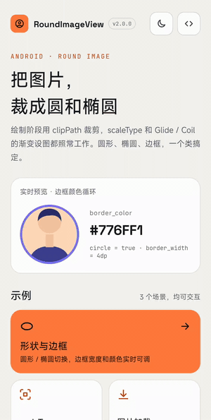
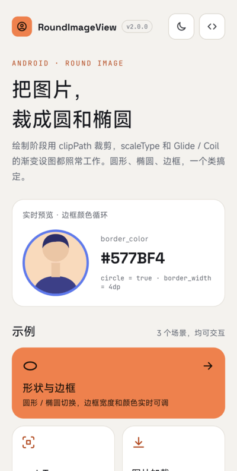
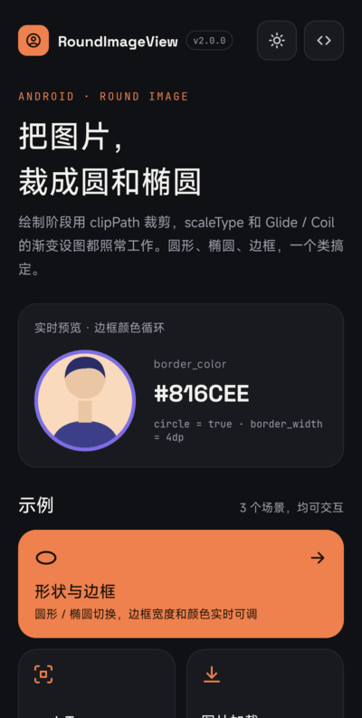
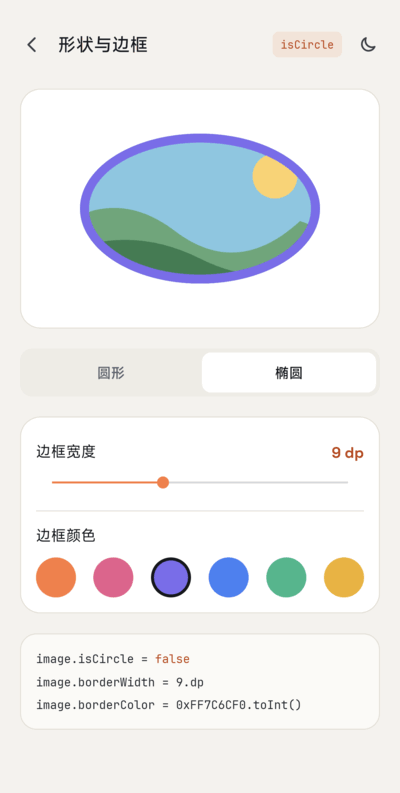
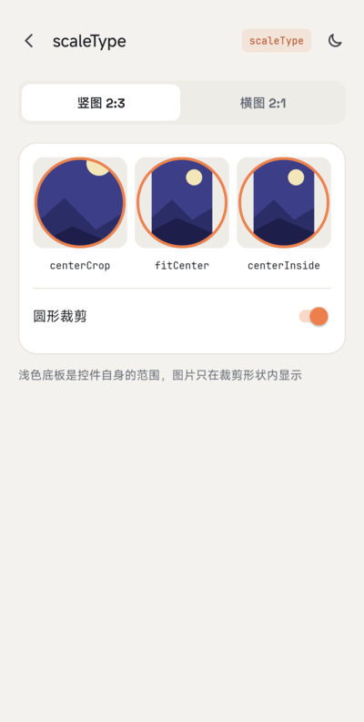
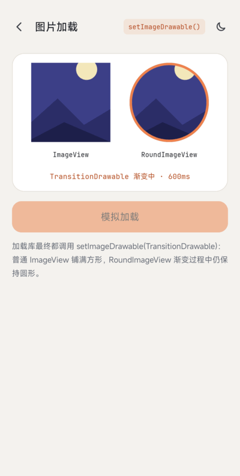

# RoundImageView

English | [简体中文](README-CN.md)

[](https://jitpack.io/#venshine/RoundImageView)  [](https://github.com/venshine/RoundImageView/actions/workflows/ci.yml)  [](https://developer.android.com/guide/topics/manifest/uses-sdk-element#ApiLevels)

An `ImageView` that clips its image to a circle or an oval, with an optional border. Written in Kotlin, no dependencies besides the Kotlin standard library.

[**Download the sample APK**](https://github.com/venshine/RoundImageView/releases/download/2.0.0/RoundImageView-sample-2.0.0.apk)

## Screenshot



| Home | Dark mode | Shape & border | scaleType |
|:---:|:---:|:---:|:---:|
|  |  |  |  |

| Image loading |
|:---:|
|  |

Do you need it?
--
Most apps no longer need a dedicated library for this:

* [`ShapeableImageView`](https://developer.android.com/reference/com/google/android/material/imageview/ShapeableImageView) from Material Components covers circles, rounded corners and strokes.
* Image loaders have their own transformations (Glide `CircleCrop` / `RoundedCorners`, Coil `CircleCropTransformation` / `RoundedCornersTransformation`).

RoundImageView is for projects that do not want to depend on Material Components: it is a single small class, works with any `Drawable`, and honors `scaleType`.

Usage
--
##### Gradle:
1. Add the JitPack repository to `settings.gradle`:
```groovy
dependencyResolutionManagement {
    repositories {
        google()
        mavenCentral()
        maven { url = 'https://jitpack.io' }
    }
}
```
2. Add the dependency to your module's `build.gradle`:
```groovy
implementation 'com.github.venshine:RoundImageView:2.0.0'
```

##### Gradle Kotlin DSL:
```kotlin
// settings.gradle.kts
dependencyResolutionManagement {
    repositories {
        google()
        mavenCentral()
        maven("https://jitpack.io")
    }
}

// build.gradle.kts
implementation("com.github.venshine:RoundImageView:2.0.0")
```

> Since 2.0.0 the library is written in Kotlin and published via JitPack. The old coordinate `com.wx.ovalimageview:roundimageview` can no longer be downloaded, and the jar for Eclipse is gone.

Demo
--
The package name is still `com.wx.ovalimageview`. The [sample app](sample) shows circle, oval, `scaleType` and an image-loader style transition, with light and dark themes.

##### XML:
```xml
<com.wx.ovalimageview.RoundImageView
    xmlns:app="http://schemas.android.com/apk/res-auto"
    android:layout_width="96dp"
    android:layout_height="96dp"
    android:scaleType="centerCrop"
    android:src="@mipmap/ic_launcher"
    app:border_color="#ff0000"
    app:border_width="2dp"
    app:circle="true" />
```

##### Kotlin:
```kotlin
val imageView = findViewById<RoundImageView>(R.id.round_imageview)
imageView.scaleType = ImageView.ScaleType.CENTER_CROP
imageView.borderColor = Color.RED
imageView.borderWidth = 10
imageView.isCircle = true
imageView.setImageResource(R.drawable.avatar)
```

##### Java:
```java
RoundImageView imageView = findViewById(R.id.round_imageview);
imageView.setScaleType(ImageView.ScaleType.CENTER_CROP);
imageView.setImageResource(R.drawable.avatar, Color.RED, 10, true);
```

##### Glide / Coil:
The image is clipped when drawn, so anything that calls `setImageDrawable` works, including cross-fade transitions (`TransitionDrawable`). Set `scaleType` on the view and let the loader do the rest:

```kotlin
// Glide: do not add transform(CircleCrop()); the view clips already
Glide.with(this).load(url).into(imageView)

// Coil
imageView.load(url)
```

If a loader applies its own `centerCrop` / `fitCenter` transformation, the view's `scaleType` still decides how the result is placed inside the view.

##### Attributes:
| attr | description |
|:---|:---|
| `border_color` | Border color. Fully transparent means no border |
| `border_width` | Border width. `0` means no border |
| `circle` | `true` clips to a circle (the shorter side of the content area is the diameter). `false` (default) clips to an oval filling the content area |

##### Methods:
| method | description |
|:---|:---|
| `borderColor` / `setBorderColor(int)` | Get / set the border color |
| `setBorderColor(String)` | Set the border color, e.g. `"#aarrggbb"` |
| `borderWidth` / `setBorderWidth(int)` | Get / set the border width in px |
| `isCircle` / `setCircle(boolean)` | Get / set circle mode |
| `setImageResource(int, int, int, boolean)` | Set the image with border color, border width and circle mode |
| `setImageDrawable(Drawable, int, int, boolean)` | Same, with a `Drawable` |
| `setImageBitmap(Bitmap, int, int, boolean)` | Same, with a `Bitmap` |

Everything else (`setScaleType`, `setImageDrawable`, padding, ...) comes from `ImageView`.

Migrating from 1.x
--
* **Coordinate**: `com.wx.ovalimageview:roundimageview:1.1.0` becomes `com.github.venshine:RoundImageView:2.0.0`; `minSdk` is now 21.
* **Clipping moved to drawing time.** `scaleType` is honored in every mode. The default is `centerCrop`, so the image fills the shape as circle mode did in 1.x; an `android:scaleType` set in XML or a style, or a later `setScaleType` call, takes precedence. In 1.x oval mode followed the `ImageView` default `fitCenter`; set `android:scaleType="fitCenter"` to keep that.
* **Any `Drawable` works.** 1.x cast the drawable to `BitmapDrawable` and crashed on `TransitionDrawable`, vector drawables and so on. `setImageDrawable(null)` now clears the image instead of throwing.
* **Setters redraw immediately.** In 1.x `setBorderColor`, `setBorderWidth` and `setCircle` only affected the next image you set.
* **`RoundDrawable` is removed.** It was an implementation detail; use `RoundImageView` directly.
* **Content area.** The shape and border follow the view's padding.
* The border is drawn inside the shape, over the outer edge of the image, as before.
* The shape is clipped with `Canvas.clipPath`. With hardware acceleration (the default) the edge is anti-aliased; on a software canvas it can look jagged.

Status
--
Maintained on a best-effort basis. The 2.0.0 rewrite has been checked on a real device running Android 17, and Robolectric unit tests check the drawn pixels.

Credits
--
The sample app bundles these fonts, both licensed under the [SIL Open Font License 1.1](https://openfontlicense.org) (license texts in [`sample/licenses/`](sample/licenses)):
* [Space Grotesk](https://github.com/floriankarsten/space-grotesk): Copyright 2020 The Space Grotesk Project Authors
* [JetBrains Mono](https://github.com/JetBrains/JetBrainsMono): Copyright 2020 The JetBrains Mono Project Authors

The library itself bundles no fonts.

License
--
    Copyright (C) 2016 venshine.cn@gmail.com

    Licensed under the Apache License, Version 2.0 (the "License");
    you may not use this file except in compliance with the License.
    You may obtain a copy of the License at

    http://www.apache.org/licenses/LICENSE-2.0

    Unless required by applicable law or agreed to in writing, software
    distributed under the License is distributed on an "AS IS" BASIS,
    WITHOUT WARRANTIES OR CONDITIONS OF ANY KIND, either express or implied.
    See the License for the specific language governing permissions and
    limitations under the License.
